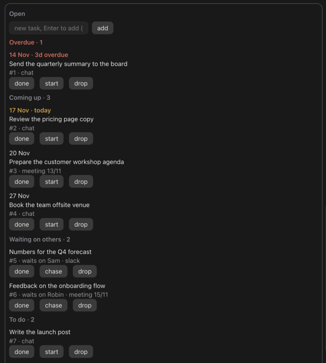

# open-loops

A board beside your Claude Code chat for what's still open: sessions waiting on you, tasks in a plain markdown file.



It shows the sessions you touched in the last 24 hours, the open rows of your tasks file, and what you closed lately. It is a Claude Code mod (a plugin of function hooks), so it runs inside Claude Code and reads only files on your own computer.

## What the board shows

**Hot.** Sessions touched in the last 24 hours, newest first, with how their last turn ended. A session that stopped waiting on you is red. `open` switches the app to it.

**Open.** The open rows of your tasks file. Overdue rows come first in red, rows due today are amber, then the rest by due date. After those come sessions from the last week that still wait on you, rows that wait on someone else (with a `chase` button that has Claude draft a follow-up for you to send), and your own undated work (with a `start` button that hands the task to Claude). `done` and `drop` change the row's status in the file. The field at the top adds a row.

**Done.** The latest closed rows (10 by default).

`/board` or `/open-loops` opens the board. `/task <text>` asks Claude to add a row, taking a due date and a person from the text when it names them. With the default settings, starting a message with `task:` works too.

In the desktop app, a session you open or come back to may not have started Claude yet. The commands are listed once it has, so after your first message in that session.

## Install

At the prompt of a Claude Code terminal session:

```
/plugin install open-loops --marketplace yoawid/open-loops
```

Answer `y` to add the marketplace, pick the user scope, then set the options below (the defaults work).

From a shell:

```bash
claude plugin install open-loops --marketplace yoawid/open-loops
```

In the desktop app: click + next to the prompt box, then Plugins, Add marketplace with `yoawid/open-loops`, then Add plugin.

## Settings

| Setting | Default | What it does |
|---|---|---|
| Tasks file | `tasks.md` | The file, relative to your home folder (or absolute, or starting with `~/`). Created with its header on the first task you add. |
| Your name in the who column | `me` | Rows with this name are yours. Any other name is someone you wait on. |
| Home folder | empty | The folder you usually work in. Sessions there show no folder label. |
| Done rows shown | `10` | How many closed rows the Done column lists. |
| Teach Claude the tasks file | on | Adds a short note to Claude's instructions so `task: …` works in any session. Turn it off if your own CLAUDE.md already covers it. |

You can change them later in `/config` in the terminal, or in `~/.claude/settings.json` under `pluginConfigs`.

## The tasks file

One markdown table, one row per task. Everything outside the table is left alone, and a change touches one line only, so you can edit the file by hand too.

```markdown
| id | added | due | who | task | source | status |
|---|---|---|---|---|---|---|
| 1 | 2026-11-17 | 2026-11-20 | me | Send the quarterly summary | chat | open |
| 2 | 2026-11-17 | | Sam | Numbers for the pricing page | slack | open |
```

`due` is `YYYY-MM-DD` or empty. `status` is `open`, `done` or `dropped`. `source` is free text. When it holds a session id (`local_…`), the row gets an `open` button that takes you back to that session.

## Platforms

The tasks part works anywhere Claude Code runs. The Hot column and the `open` buttons read the session records the Claude desktop app keeps. On macOS that is tested. On Windows (`%APPDATA%\Claude`) and Linux (`~/.config/Claude`) the plugin looks in the usual places but nobody has tested it there yet. When it finds no records, the column says so and the rest of the board works.

## Privacy

The board reads your tasks file and the desktop app's session records on your own disk, and writes only to the tasks file. It sends nothing anywhere. The `start`, `chase` and `/task` buttons put a prompt in your chat, which goes to Claude like anything else you type.

## Development

```bash
claude plugin validate .
claude plugin test .
```

MIT licence.
